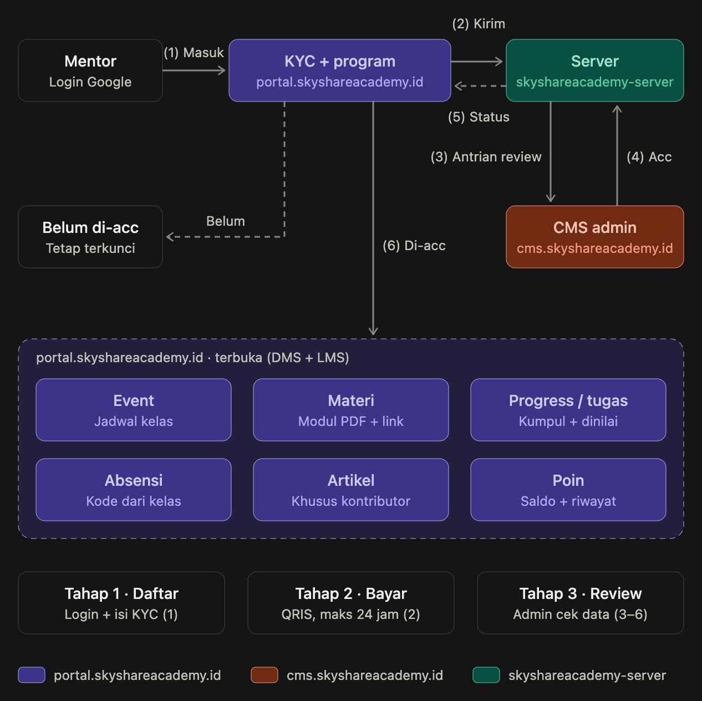

# SkyShare Academy — Member Portal

Portal terpadu berbasis web untuk anggota dan peserta ekosistem **SkyShare Academy** (khusus Mentor, Talent, Parent, dan Visitor), dibangun dengan performa tinggi, desain responsif mobile-first, serta estetika visual **Industrial Skeuomorphism**.

---

## 1. Tentang Aplikasi & Target Pengguna

SkyShare Academy Member Portal dirancang untuk memfasilitasi operasional pembelajaran, presensi kelas, penugasan berjenjang, dan manajemen profil anggota:

- **4 Peran Utama Portal**:
  - **Admin**: Dikelola secara terpisah melalui antarmuka CMS manajemen.
  - **Mentor**: Anggota terdaftar yang memiliki verifikasi identitas (KYC) disetujui dan aktif dalam program Mentor Academy Nusantara (`MAN`) atau TeachMe Series (`TEACHME_SERIES`).
  - **Talent**: Peserta aktif atau alumni jalur pengembangan talenta.
  - **Parent**: Orang tua siswa pada program Parent Academy (`PARENT_ACADEMY`).
- **Tingkat Akses Publik**:
  - **Visitor**: Pengguna baru yang masuk melalui Google OAuth namun belum memiliki enrollment program aktif. Hak akses terbatas pada melihat Katalog Program, Formulir KYC, dan Profil.
  - **Verified Visitor**: Visitor yang data KYC-nya telah diverifikasi dan disetujui admin, namun belum mendaftar/membayar program.

---

## Alur Portal



Alur operasional pendaftaran dan pembukaan hak akses portal mencakup **Tahap 1: Daftar**, **Tahap 2: Bayar QRIS (maks 24 jam)**, dan **Tahap 3: Review**:
1. **Masuk via Google + KYC**: Pengguna masuk akun menggunakan Google OAuth 2.0 dan melengkapi data verifikasi identitas (KYC).
2. **Kirim ke Server**: Formulir identitas dan checkout pesanan program (beserta kode unik QRIS) dikirimkan ke server backend.
3. **Antrean Review di CMS**: Data pengajuan KYC dan berkas bukti bayar masuk ke antrean verifikasi admin pada antrean review CMS.
4. **Admin ACC**: Administrator memvalidasi kecocokan mutasi transfer dan menyetujui berkas identitas peserta.
5. **Status Kembali ke Portal**: Server memperbarui hak akses pengguna secara realtime (`APPROVED`) saat kembali ke portal.
6. **Akses Terbuka Penuh**: Seluruh modul fungsional langsung dapat diakses, meliputi Agenda Event, Modul Materi, Progres Belajar & Tugas, Presensi Pertemuan (OTP), Ruang Artikel (khusus kontributor), serta Saldo Poin.

---

## 2. Tech Stack & Versi

Berdasarkan dependensi aktif pada `package.json`:

| Kategori | Paket | Versi | Deskripsi |
| :--- | :--- | :--- | :--- |
| **Framework** | `vue` | `^3.5.41` | Vue 3 dengan Composition API dan `<script setup>` |
| **Build Tool** | `vite` | `^8.2.2` | Bundler modul generasi baru ultra-cepat |
| **Language** | `typescript` | `~6.0.2` | Type-safety dengan `vue-tsc` (`^3.3.11`) |
| **Styling** | `tailwindcss` | `^4.3.3` | Tailwind CSS v4 dengan `@tailwindcss/vite` |
| **State** | `pinia` | `^4.0.3` | State management modular dan reaktif |
| **Routing** | `vue-router` | `^5.3.1` | Navigasi SPA dengan route guards berbasis hak akses server |
| **Motion** | `gsap` | `^3.15.0` | GreenSock Animation Platform untuk animasi fisika skeuomorphic |
| **HTTP Client** | `axios` | `^1.20.0` | Client HTTP dengan interceptor single-flight dan penanganan error |
| **Icons & Utils**| `lucide-vue-next` / `@vueuse/core` | `^1.0.0` / `^14.4.0` | Ikon visual dan utilitas reaktif |
| **Linting** | `eslint` / `eslint-plugin-vue` | `^10.10.0` / `^10.10.0` | Standar kode dan verifikasi sintaks |

---

## 3. Prasyarat Sistem (Prerequisites)

- **Node.js**: Versi `>= 20.0.0` (direkomendasikan Node.js 22 LTS atau v26)
- **pnpm**: Versi `>= 9.0.0` (diverifikasi pada pnpm 12.4.1)
- **Backend API**: Server SkyShare Academy aktif pada port 3002 (`http://localhost:3002`)

---

## 4. Setup & Konfigurasi Lingkungan

1. Instalasi seluruh dependensi project:
   ```bash
   pnpm install
   ```

2. Salin template variabel lingkungan:
   ```bash
   cp .env.example .env
   ```

3. Konfigurasi variabel pada file `.env`:

| Nama Variabel | Wajib | Contoh Nilai | Deskripsi |
| :--- | :---: | :--- | :--- |
| `VITE_API_BASE_URL` | Ya (Prod) / Opsional (Dev) | `http://localhost:3002` | URL origin backend API SkyShare. Pada mode DEV default ke `http://localhost:3002`. Pada mode produksi wajib diisi dan tidak lagi fallback diam-diam ke localhost. |
| `VITE_GOOGLE_CLIENT_ID` | Ya | `1234567890-xxx.apps.googleusercontent.com` | Google OAuth 2.0 Web Client ID untuk tombol login Google Identity Services (GIS). |

---

## 5. Menjalankan Aplikasi Secara Lokal

Jalankan development server:
```bash
pnpm run dev
```

Aplikasi portal akan aktif pada:
```text
http://localhost:5175  (atau http://localhost:5173 jika port kosong)
```

> **Catatan Server & Database:**
> - Pastikan backend API berjalan di `http://localhost:3002`.
> - Jangan pernah mengarahkan koneksi pengembangan ke database produksi. Selalu gunakan database lokal PostgreSQL (misal `skyshare_dev`).

---

## 6. Daftar Perintah Script

| Perintah | Deskripsi |
| :--- | :--- |
| `pnpm run dev` | Menjalankan Vite development server dengan hot-module replacement (HMR). |
| `pnpm run build` | Menjalankan typecheck `vue-tsc` dan build bundel produksi ke direktori `dist/`. |
| `pnpm run typecheck` | Menjalankan pengecekan tipe statis TypeScript tanpa menghasilkan output (`vue-tsc --noEmit`). |
| `pnpm run lint` | Memeriksa seluruh file kode terhadap aturan ESLint (Vue, TypeScript, JavaScript). |
| `pnpm run lint:fix` | Memperbaiki kesalahan gaya kode yang dapat diselesaikan otomatis oleh ESLint. |
| `pnpm run preview` | Menyajikan hasil build folder `dist/` secara lokal untuk pengujian pra-rilis. |

---

## 7. Struktur Direktori Proyek

Arsitektur aplikasi menggunakan pola **pages-stores-components**:

```text
skyshareacademy-portal/
├── public/                     # Aset publik statis (favicon, logo, ikon maskot pose 1-10)
├── src/
│   ├── api/
│   │   └── client.ts           # Instance Axios, base URL resolver, interceptor 401 & 403 single-flight
│   ├── components/
│   │   └── common/             # Pustaka komponen UI skeuomorphic reusable
│   │       ├── AppPage.vue     # Container standar lebar halaman, padding responsif, dan header HUD
│   │       ├── AppAlert.vue    # Alert status (success, error, warning, info)
│   │       ├── AppBadge.vue    # Badge label metalik dengan indikator LED
│   │       ├── AppButton.vue   # Tombol mekanikal 3D dengan status loading & tactile press
│   │       ├── AppEmptyState.vue # Panel kosong skeuomorphic dengan maskot
│   │       ├── AppInput.vue    # Field input form recessed inner shadow & a11y label
│   │       ├── AppSelect.vue   # Dropdown custom dengan chevron mekanikal dan label monospaced
│   │       ├── AppSkeleton.vue # Efek loading shimmer berbasis chasis industri
│   │       └── AppToastContainer.vue # Sistem notifikasi floating toast melayang
│   ├── composables/
│   │   └── useAlert.ts         # Composable reaktif toast & alert flash persisten lintas navigasi
│   ├── layouts/
│   │   ├── AuthLayout.vue      # Layout halaman autentikasi Google
│   │   └── PortalLayout.vue    # Layout utama portal (Header HUD, Drawer menu, Taskbar Dock)
│   ├── pages/
│   │   ├── auth/
│   │   │   └── LoginPage.vue   # Halaman masuk Google Identity Services dengan tombol responsif
│   │   └── portal/
│   │       ├── DashboardPage.vue     # Ringkasan statistik, progres kelas, dan materi aktif
│   │       ├── ProgramsPage.vue      # Katalog program, filter kategori/level, checkout QRIS & bukti bayar
│   │       ├── KycPage.vue           # Form pengajuan KYC mentor, data rekening, upload KTP 5 MB & withdraw
│   │       ├── AssignmentsPage.vue   # Unggah lembar tugas, evaluasi nilai admin, dan progres presensi
│   │       ├── EventsPage.vue        # Agenda sesi kelas bootcamp dan indikator presensi OTP aktif
│   │       ├── EventDetailPage.vue   # Detail pertemuan, link Zoom, dan presensi kode 6-digit OTP
│   │       ├── MaterialsPage.vue     # Modul pembelajaran, download PDF bertanda tangan, dialog artikel
│   │       ├── MaterialDetailPage.vue# Halaman pembaca konten materi pembelajaran
│   │       ├── ManageArticlesPage.vue# Workspace kontributor artikel (draf, edit, submit review)
│   │       └── ProfilePage.vue       # Informasi akun, badge hak akses, dan riwayat ledger poin
│   ├── router/
│   │   └── index.ts            # Definisi rute, meta guard (requiresAuth, requiresAccess, requiresContributor)
│   ├── stores/
│   │   ├── auth.ts             # Pinia store autentikasi pengguna
│   │   └── access.ts           # Pinia store hak akses server-derived, status KYC, order, dan asesmen
│   ├── types/
│   │   └── index.ts            # Tipe TypeScript model bisnis dan respons API
│   ├── utils/
│   │   ├── animations.ts       # Utilitas GSAP (staggered entrance, LED pulse, mascot float, counter)
│   │   └── url.ts              # Resolusi URL aset publik & private signed storage
│   ├── App.vue                 # Root component aplikasi
│   ├── main.ts                 # Entry point inisialisasi Vue, Pinia, dan Router
│   └── style.css               # Konfigurasi Tailwind CSS v4 dan variabel desain skeuomorphic
├── .env.example                # Dokumentasi konfigurasi environment
├── package.json                # Dependensi dan script npm/pnpm
└── vite.config.ts              # Konfigurasi bundler Vite dan alias direktori (@)
```

---

## 8. Fitur Utama & Alur Pengguna

### 1. Verifikasi Identitas Mentor (KYC)
- Mendukung status berjenjang: `REGISTERED`, `KYC_SUBMITTED`, `PENDING_REVIEW`, `APPROVED`, dan `REJECTED`.
- Proteksi privasi: NIK dan nomor rekening lama otomatis disamarkan (*masked*). Pengguna dapat memilih untuk tetap menggunakan data lama atau mengedit ulang.
- Berkas KTP lama dipertahankan via flag `has_ktp`, sehingga perbaikan data teks tidak mewajibkan unggah ulang foto KTP jika sudah ada.
- Penarikan berkas (*withdraw*) mandiri kembali ke draf sebelum diverifikasi admin.
- Pembersihan URL memori pratinjau blob otomatis saat pemilihan berkas atau perpindahan halaman.

### 2. Katalog Program & Pembayaran QRIS
- **Kategori Program**: Mentor Academy Nusantara (`MAN`), TeachMe Series (`TEACHME_SERIES`), dan Parent Academy (`PARENT_ACADEMY`).
- **Pendaftaran Gratis**: Tersedia untuk program non-MAN setelah KYC berstatus `APPROVED`.
- **Checkout Pembayaran QRIS (MAN)**:
  - Pembentukan pesanan dengan nominal persis beserta kode unik acak 3 digit.
  - Timer hitung mundur kedaluwarsa dinamis 2 jam dengan indikator visual.
  - Upload berkas struk bukti transfer dengan verifikasi ukuran (maksimal 5 MB) dan tipe berkas gambar.
- **Pengecekan Prasyarat Level**: Jenjang `INTERMEDIATE` mewajibkan kelulusan level `BASIC`, dan `ADVANCE` mewajibkan kelulusan level `INTERMEDIATE`.

### 3. Presensi Pertemuan dengan TOTP
- Mahasiswa/mentor mengisi kode 6-digit numerik pada halaman detail agenda kelas ketika presensi dibuka admin.
- Input mendukung mode numerik mobile (`inputmode="numeric"`), autocomplete one-time-code, serta auto-submit dan paste clipboard.
- Penanganan status server komprehensif: 200 (berhasil tercatat), 409 (sudah absen), 400 (sesi ditutup/kode salah), 403 (bukan peserta), dan 429 (lockout pendinginan sementara).

### 4. Progres Belajar & Evaluasi Kelulusan
- Ringkasan kehadiran sesi kelas $x/y$ ($rate\%$) per cohort program.
- Pengumpulan berkas penugasan dan tautan tugas dengan riwayat catatan revisi dari admin/mentor penguji.
- Banner hasil asesmen kelulusan jenjang (`Lulus`, `Tidak Lulus`, `Menunggu Penilaian`) disertai feedback dan tanggal yudisium.

### 5. Workspace Kontributor Artikel
- Dibatasi khusus pengguna dengan grant hak kontributor (`is_contributor === true`).
- Pengelolaan draf artikel edukasi, pemilihan kategori, penyuntingan isi materi, dan pengajuan review ke admin.
- Status draf transparan: `Draft`, `Menunggu Review`, `Terbit`, atau `Ditolak` disertai alasan penolakan.

### 6. Sistem Poin & Gamifikasi
- Indikator saldo poin aktif pada header konsol dan profil.
- Tabel ledger riwayat mutasi poin (perolehan tugas, kontribusi artikel, penyesuaian admin).

---

## 9. Catatan Keamanan (Security Notes)

1. **Google Identity Services (GIS)**: Login portal murni menggunakan Google OAuth 2.0. Tidak ada kata sandi mentah yang disimpan di portal. Token sesi disimpan dalam cookie `httpOnly` yang aman.
2. **Private Storage & Signed URLs**: Berkas KTP identitas dan dokumen modul PDF tersimpan di penyimpanan privat server dan hanya dapat diunduh melalui tautan HMAC berumur pendek (TTL 5 menit).
3. **Pencegahan 403 Storm & Single-Flight**: Interceptor Axios menggunakan promise singleton tingkat modul dan cooldown timer untuk mencegah pemanggilan berulang `GET /portal/me/access` serta loop redirect ketika beberapa request paralel mengalami 403.
4. **Pencegahan XSS**: Konten artikel, instruksi tugas, dan pesan pengguna selalu dirender menggunakan interpolasi teks aman Vue (`{{ ... }}`) dan elemen input form murni. Tidak ada pemanggilan `v-html` untuk konten artikel.
5. **AbortController Request Cancellation**: Pemuatan daftar data pada halaman utama membatalkan request lama yang masih berjalan secara otomatis jika pengguna beralih tab, memilih filter baru, atau meninggalkan rute halaman (*unmount*).

---

## 10. Panduan Deploy ke Lingkungan Development / Staging

1. **Build Artefak Statis**:
   ```bash
   pnpm run build
   ```
   Folder `dist/` berisi seluruh aset statis HTML, CSS, JavaScript, dan media yang telah dioptimasi.

2. **Konfigurasi Environment Build**:
   - Pastikan variabel `VITE_API_BASE_URL` telah disetel ke endpoint REST API development/staging yang dituju (misal: `https://api-dev.skyshareacademy.id`).
   - Bundle produksi akan menampilkan peringatan konsol fatal jika `VITE_API_BASE_URL` tidak didefinisikan saat build.

3. **Web Server Host**:
   - Sajikan folder `dist/` menggunakan Nginx, Cloudflare Pages, atau Caddy dengan konfigurasi fallback SPA:
     ```nginx
     location / {
         try_files $uri $uri/ /index.html;
     }
     ```

4. **Konektivitas Cookie & CORS**:
   - Pastikan backend server menambahkan domain portal ke dalam whitelist header `Access-Control-Allow-Origin` dengan `credentials: true`.
   - Jika portal dan server berbeda subdomain pada protokol HTTPS, pastikan konfigurasi cookie session di backend memiliki flag `SameSite=None; Secure`.

---

## 11. Solusi Kendala Umum (Troubleshooting)

- **Port 5175 Sudah Digunakan**:
  Jika port `5175` atau `5173` sedang dipakai instance lain, hentikan proses yang berjalan dengan `kill -9 $(lsof -t -i:5175)` atau jalankan `pnpm run dev --port 5176`.
- **Galat "500_FAILED" atau Akses Terputus saat Login**:
  Periksa apakah backend API pada port `3002` aktif dan dapat menerima koneksi database.
- **Tombol Google Login Tidak Muncul / "Origin Not Allowed"**:
  Pastikan URL lokal (misal: `http://localhost:5175` dan `http://localhost:5173`) telah didaftarkan dalam daftar **Authorized JavaScript Origins** pada Google Cloud Console proyek OAuth.
- **File KTP / Struk Transfer Gagal Diunggah**:
  Pastikan ukuran file tidak melebihi 5 MB dan berformat `.jpg`, `.png`, atau `.webp`.
- **Akses Halaman Ditolak (403 FORBIDDEN)**:
  Pengguna dengan status *Visitor* hanya dapat membuka menu Program, KYC, dan Profil. Untuk membuka Modul, Penugasan, dan Jadwal Event, pengguna wajib menyelesaikan verifikasi KYC dan terdaftar aktif dalam program.
